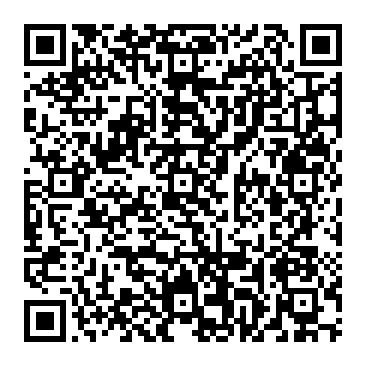

# Cairns Engineering Society

Welcome to the **Cairns Engineering Society (CES)**, the student society for engineering students at JCU Cairns.

This site puts the things engineering students need in one place, so you don't have to dig through the JCU website.

## Quick links

- [About CES and how to get involved](about.md)
- [Events this trimester](events.md)
- [Subjects: what they're actually like](subjects/index.md)
- [Placement: step by step](placement.md)
- [Things nobody tells you](things-nobody-tells-you.md)
- [Student testimonials](testimonials.md)
- [Useful JCU links](resources.md)
- [CES documents (constitution, minutes)](documents.md)

## Latest news

<!--
  HOW TO ADD NEWS:
  Copy the line below, paste it at the TOP of the list, and change the date and text.
  - **[Date, e.g. 10 Oct 2026]**: [What's new, e.g. "Trimester 3 BBQ dates are out! See the [events page](events.md)."]
  Keep only the 3–5 most recent items. Delete older ones.
-->

- **October 2026**: The new CES website is live! Have something that should be on here? [Let us know](https://forms.gle/n4fg7VV2BTVFQaYu6).

## Calendar

All CES events are on the calendar below. Click an event for details.

<!--
  This calendar shows the "CES Events" Google Calendar (owned by cairns.engineering.society@gmail.com).
  To add events, add them in Google Calendar (see _guides/02-adding-an-event.md). You don't edit anything here.

  CALENDAR VIEW: the end of the web address below says  &mode=AGENDA  (a list of upcoming events, easiest on phones).
  To change the view, change only the word after mode= :
    &mode=AGENDA  = list of upcoming events (current)
    &mode=MONTH   = month grid (cramped on phones)
    &mode=WEEK    = week view
  Full instructions: _guides/11-setup-google-calendar.md, section "Changing the calendar view".
-->

<iframe src="https://calendar.google.com/calendar/embed?src=d9d1f1f2576f01714405e7e2301d3a6141c72bc7d1812b0f5403b1379cc56b9e%40group.calendar.google.com&ctz=Australia%2FBrisbane&mode=AGENDA" style="border: 0" width="100%" height="600" frameborder="0" scrolling="no"></iframe>

### Add the CES calendar to your phone

Subscribe once and every CES event appears in your own calendar automatically. You can't edit it, and you don't have to do anything else.

- [Google Calendar / Android](https://calendar.google.com/calendar/u/0?cid=ZDlkMWYxZjI1NzZmMDE3MTQ0MDVlN2UyMzAxZDNhNjE0MWM3MmJjN2QxODEyYjBmNTQwM2IxMzc5Y2M1NmI5ZUBncm91cC5jYWxlbmRhci5nb29nbGUuY29t)
- [iPhone / Outlook / other calendar apps](webcal://calendar.google.com/calendar/ical/d9d1f1f2576f01714405e7e2301d3a6141c72bc7d1812b0f5403b1379cc56b9e%40group.calendar.google.com/public/basic.ics)

Or scan this QR code with your phone camera:

## Help improve this site

Know something that should be here, or spotted a mistake? [Send us a suggestion](https://forms.gle/n4fg7VV2BTVFQaYu6).

---

*Cairns Engineering Society (CES) · A student-run site, not an official JCU website · [Suggest a change](https://forms.gle/n4fg7VV2BTVFQaYu6)*
